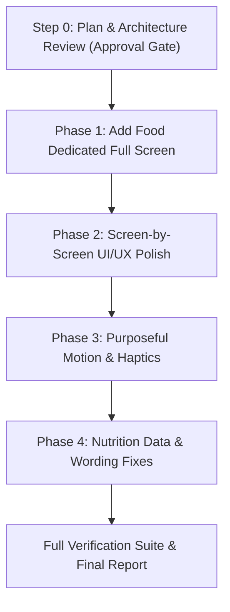

# FitTrack v4 — Comprehensive Mobile UI/UX Architecture & Execution Plan

**Author:** Senior Mobile Developer  
**Design System:** Editorial Ledger (`#FAF7F2` warm ivory, `#1E3A2F` deep forest green, `#7A9283` muted sage, `#C1664C` terracotta)  
**Target Platform:** Android & iOS (Expo SDK 57 / React Native 0.86 / React 19 / TypeScript)  
**Viewports Tested:** 360x640 dp, 360x800 dp, 412x915 dp, and up to 200% system font scaling.

---

## Executive Summary & Design Principles

Following the **`mobile-app-ui-design`** skill and the Google Stitch *Editorial Ledger* design identity, FitTrack v4 will be upgraded from cluttered modal sheets to a calm, high-density, high-efficiency editorial interface. 

### Core Ground Rules
1. **Visual Identity:** Retain the warm ivory canvas (`theme.colors.background`), forest green brand (`theme.colors.primary`), muted sage (`theme.colors.secondary`), terracotta accents (`theme.colors.accent`), Newsreader serif headlines, and Inter sans body text.
2. **Zero Raw Hex & Font Sizes:** Strict token enforcement through `src/theme.ts`. Automated checks `scripts/scanHex.ts`, `scripts/scanFontSize.ts`, and `scripts/auditAccessibility.ts` must pass with zero findings.
3. **Multilingual & RTL:** Complete translation in English (`en`), Arabic (`ar`), and Kurdish Sorani (`ckb`) with correct writing direction and mirrored layout where appropriate. Review entries maintained in `docs/localization-review.csv`.
4. **Accessibility (WCAG AA):** Minimum 44×44 dp touch targets (via padding or `hitSlop`), contrast ratios $\ge 4.5:1$ for text and $\ge 3.0:1$ for large UI indicators, dynamic text scaling support up to 200% without clipped words.
5. **Preserved Existing Features:** Stay-open multi-item logging, session tray with Undo and total kcal, streak calculation, deferred goal celebrations, keyboard handling, offline SQLite/AsyncStorage persistence, barcode lookup with offline fallback, Gemini plate photo/describe analysis, and micronutrient RDA calculations.

---

## 1. Project Audit: Issues Identified per Screen

### 1.1 Add Food Modal Sheet (`src/components/addfood/AddFoodSheet.tsx`)
- **Excessive Top-Heavy Controls:** On a 360×800 dp Android device, the upper controls take over 50% of the viewport (meal slot chips, 3 segmented tabs, search bar, barcode button, manual barcode drawer, filter chips row, and quick action chips row).
- **Over-Sized Food Rows:** Each food item card is ~240 dp tall due to large thumbnails, vertical badge stacking, ingredient previews, macro chips, and multi-row layout, resulting in only 1.5 to 2 foods visible simultaneously.
- **Visual Clutter & Confusion:** Filter chips (All, Recent, Frequent, Favorites, Templates, Regional, Custom, Scanned) and quick actions (Copy yesterday, Quick add, Templates) look identical, confusing users on where to tap.
- **Obstructive Session Tray:** The current session footer renders a full-width solid bar across the bottom even when nothing has been added yet, obscuring list items and creating visual dead space.
- **Premature Sheet Dismissal:** Adding a food currently triggers a timeout and closes the sheet after 450 ms, preventing rapid sequential multi-item logging.
- **Performance Lag:** The food list renders all 70+ verified and regional foods inside a non-virtualized `ScrollView` with `.map()`, creating initial render lag and frame drops during search filtering.

### 1.2 Today / Dashboard Screen (`src/screens/DashboardScreen.tsx`)
- **Touch Target Inconsistencies:** The meal section "+" buttons (`styles.plusIconCircle`) and water increment buttons are 36×36 dp without sufficient `hitSlop`, falling below the 44 dp minimum.
- **Scroll Cutoff Behind Floating Dock:** The bottom dock is floating (`insets.bottom + 8`), but the `ScrollView` content padding calculation does not always clear the floating dock on Android edge-to-edge gesture navigation or 3-button bars.
- **Card Spacing Hierarchy:** Inconsistent vertical margins (some 8 dp, some 12 dp, some 16 dp) break the 8-point rhythm.
- **Font Scaling Clipping:** Macro numerical values wrap awkwardly when system accessibility font size is set to 200%.

### 1.3 Meals / Diary Screen (`src/screens/FoodLogScreen.tsx`)
- **Fragmented Entry Points:** Currently renders its own internal instance of `AddFoodSheet` modal instead of routing through the global navigation flow.
- **Date Navigation Tap Targets:** Header date arrows (`ChevronLeft` / `ChevronRight`) have small tap targets (< 40 dp).
- **Meal Section Visual Density:** Empty meal sections take up too much vertical space with redundant empty states.
- **RTL Alignment in Date Bar:** Date strings with mixed numerals and Kurdish/Arabic text occasionally suffer from bidirectional text isolation issues.

### 1.4 AI Coach Screen (`src/screens/CoachScreen.tsx`)
- **Chat Input Bar Ergonomics:** The text input container is cramped when keyboard opens; the Send button touch area is small (32 dp).
- **Empty State Guidance:** When no chat history exists, the screen presents a bare prompt rather than structured conversational starters (e.g., "Review today's protein", "Plan a recovery dinner").
- **Message Bubble Contrast:** AI response bubbles in dark mode use subtle borders that can lack clear separation from the background.

### 1.5 Progress Screen (`src/screens/ProgressScreen.tsx`)
- **Hardcoded Chart Colors:** Chart visualization legends and series lines use hardcoded hex values (`#10B981`, `#D97706`, `#3B82F6`) instead of `theme.colors.*`.
- **Time Range Selector Tap Area:** 7-day and 30-day pills have tight touch boundaries (< 36 dp).
- **Log Weight Dialog:** Form inputs and buttons use one-off inline styles rather than shared design tokens.

### 1.6 Profile & Settings Screen (`src/screens/ProfileScreen.tsx`)
- **Density & Grouping:** Long, flat list of cards without clear visual categorization between Account, Nutritional Targets, Reminders, and Privacy/Crash Reporting.
- **Target Preview Card:** Custom styles not unified with standard card component.
- **Tap Targets on Settings Rows:** Chevron right icons and toggle switches need consistent 48 dp row heights.

### 1.7 Steps Screen (`src/screens/StepsScreen.tsx`)
- **Back Button Tap Target:** 20 dp icon inside 32 dp button container.
- **Bottom Safe Area Padding:** Fixed bottom padding causes buttons to sit flush against the Android gesture navigation pill.

### 1.8 Supplements Screen (`src/screens/SupplementsScreen.tsx`)
- **Complex Modal Form:** The modal for creating or editing routine items spans over 1,000 lines with multiple nested horizontal chip lists, resulting in high cognitive load.
- **Check-off Hit Area:** Circle checkboxes for logging daily intake need generous 48 dp hit targets.

### 1.9 Workouts Screen (`src/screens/WorkoutsScreen.tsx`)
- **Category Filter Chips:** Horizontal scrolling chips have uneven text padding and small vertical hit boundaries.
- **Bottom Dock Padding:** Content scrolls under the floating dock on small devices.

### 1.10 Account Screen (`src/screens/AccountScreen.tsx`)
- **Diagnostic Text Overflow:** The diagnostic panel dumps formatted text that can overflow small 360 dp width screens.
- **Button Sizing:** Google Sign-In and email action buttons use hardcoded dimensions inconsistent with the 56 dp primary CTA standard.

### 1.11 Modals and Dialogs (All)
- Varying backdrop opacities (`rgba(0,0,0,0.5)`, `rgba(31,36,33,0.45)`, etc.).
- Inconsistent modal header heights and close button placements.
- Missing bottom safe-area insets when keyboard is dismissed.

---

## 2. Phase-by-Phase Implementation Plan

---

### Phase 1: Add Food as a Dedicated Full Screen

#### 1. Architecture & Navigation Integration
- Convert `AddFoodSheet` from a modal sheet to a dedicated full-screen component: `src/screens/AddFoodScreen.tsx`.
- Connect into `App.tsx` state machine via `tempScreen === 'add-food'` (matching `'supplements'`, `'profile'`, etc.).
- All entry points route into `tempScreen = 'add-food'`:
  - Floating action button on Today screen.
  - Per-meal slot "+" buttons on Today screen (passing `mealType` and `targetDate`).
  - Add button in Diary / Meals tab.
  - Quick Action Sheet food logging triggers.
- Support native Android hardware back press and explicit "X" top bar button to return cleanly with zero state loss.

#### 2. Compact Top Bar & Search Integration
- **Top Bar (56 dp max):**
  - Left: Close ("X") button with 48×48 dp touch area.
  - Center: Screen title ("Add food") in Newsreader serif (`theme.typography.title2`).
  - Right: Compact meal selector pill / dropdown (`Breakfast`, `Lunch`, `Dinner`, `Snack`) with active indicator.
- **Search & Action Bar:**
  - Search input with placeholder "Search foods...".
  - Beside search input: 3 compact icon buttons (44×44 dp):
    - [Barcode Scanner] icon button.
    - [Plate Camera] icon button.
    - [AI Describe] icon button.
  - Replaces the 3 massive segmented tabs that took up 120 dp of vertical height.
- **Collapsible Header on Scroll:**
  - When scrolling down in the food list, the meal selector and quick action rows collapse smoothly; the search input remains pinned or easily accessible.
  - Expands smoothly on upward scroll.

#### 3. Distinct Filters & Slim Categories
- **Row 1 — Collections Filter (36 dp height):** `All`, `Recent`, `Frequent`, `Favorites`, `Iraqi & Kurdish`, `Custom`.
- **Row 2 — Category Pills (28 dp height, visually distinct):** Slim pill design with subtle background (`theme.colors.surfaceSubtle`) and soft border (`theme.colors.border`) to avoid looking identical to collections.
- **Secondary Actions Overflow ("+ / More" Menu):**
  - Secondary actions moved out of the main screen header into a clean BottomSheet / Menu:
    - Quick Add calories/macros.
    - Copy yesterday's meal.
    - Meal templates.
    - Manual barcode digit lookup.

#### 4. High-Density Virtualized Food List
- Implement `FlatList` with `initialNumToRender={12}`, `maxToRenderPerBatch={10}`, and `windowSize={5}`.
- **Compact Food Item Row ($\le 88$ dp tall):**
  - **Line 1:** Food Name (bold, serif, truncated at 1 line with full accessibility label) + Calories on the right (bold monospace numerals).
  - **Line 2:** Serving size / portion unit + Protein / Carbs / Fat breakdown + Small verified/estimate badge + Favorite star button (44×44 dp tap target).
- At 360×800 dp, the food list occupies **$\ge 60\%$** of viewport height.

#### 5. Portion Details Step & Primary CTA
- Tapping a food item does **not** push down the list in-place.
- Opens a dedicated portion sheet/overlay:
  - Food title, verified badge, and macro chart preview.
  - Variant selector pills (e.g. 100g, 1 piece, 1 bowl).
  - Ingredient breakdown (for regional recipe foods).
  - Number stepper / direct gram input.
  - Single **sticky, full-width 56 dp primary button**: "Add to [Meal]" with high-contrast text.

#### 6. Non-Obstructive Floating Session Tray
- The session tray **never** renders as a static full-width band.
- Appears **only** after $\ge 1$ item has been logged in the current session.
- Floating card anchored above the bottom safe area:
  - Left: Added count (e.g., "3 items · 640 kcal").
  - Center: Quick "Undo" button to remove the last added food.
  - Right: "Done" primary pill button to finish and exit.
- `FlatList` dynamically adjusts `contentContainerStyle.paddingBottom` by the tray height + safe insets so the last food item is never obscured.

---

### Phase 2: Screen-by-Screen UI/UX Polish

Each screen will be systematically reviewed, refined using shared tokens, and verified against WCAG AA touch targets and 200% font scaling:

1. **Today / Dashboard (`DashboardScreen.tsx`):**
   - Unify card paddings to 16 dp on an 8-point grid.
   - Refactor meal section cards: 48 dp touch target on "+", clear macro progress bars.
   - Ensure dynamic bottom safe area padding (`insets.bottom + dockHeight + 16`).
2. **Diary / Meals (`FoodLogScreen.tsx`):**
   - Reroute all "Add Meal" buttons directly to full-screen `AddFoodScreen`.
   - Date header navigation hitSlop $\ge 44$ dp.
   - Expandable meal cards with unified macro breakdown.
3. **AI Coach (`CoachScreen.tsx`):**
   - Redesign chat empty state with editorial prompt starters.
   - Clean, full-width bottom input bar with 48 dp touch targets.
   - Proper Android keyboard avoidance padding.
4. **Progress (`ProgressScreen.tsx`):**
   - Replace raw colors with `theme.colors.*` in charts.
   - 44 dp tap targets on 7d/30d and weight/nutrition selectors.
5. **Profile & Settings (`ProfileScreen.tsx`):**
   - Group settings into ledger sections with clean section headers.
   - Standardize rows to 52 dp minimum height with consistent icons and chevrons.
6. **Steps (`StepsScreen.tsx`), Supplements (`SupplementsScreen.tsx`), Workouts (`WorkoutsScreen.tsx`), Account (`AccountScreen.tsx`):**
   - Standardize header bar across all secondary screens: 48 dp back button, serif title, subtitle.
   - Ensure safe area bottom insets so buttons never sit on Android navigation bars.
7. **Modals & Dialogs (All 12 Modals):**
   - Standardize backdrop color (`theme.colors.backdrop`), corner radius (`theme.radius.xl`), and close button hit targets.

---

### Phase 3: Purposeful Motion & Micro-Interactions

- **Engine:** React Native Reanimated v4 + `expo-haptics`.
- **Motion Budget:** 150–250 ms duration, transform and opacity only, ease-out curves (`Easing.out(Easing.quad)`).
- **Accessibility:** Strict check on `isReducedMotion()` — instantly snap to final state if user prefers reduced motion.
- **Specific Interaction Points:**
  1. *Screen Open/Close:* Subtle vertical slide (12 dp $\to$ 0 dp) + fade-in (180 ms).
  2. *Adding Food Confirmation:* Gentle scale-pop on the floating session tray (1.0 $\to$ 1.05 $\to$ 1.0 in 200 ms) + light success haptic.
  3. *Undo / Remove Item:* Fast opacity fade + slide-out (150 ms) + selection haptic.
  4. *Daily Target Reached:* Gentle celebration badge glow (250 ms).
  5. *Buttons & Touchables:* Pressable scale feedback (0.98 scale on press).
- **Prohibitions:** Zero layout animations on bulk food lists; no delayed input response.

---

### Phase 4: Nutrition Data & Wording Fixes

1. **Common Fruits USDA Verification:**
   - Verify records for: *Fresh Red Apple*, *Fresh Sweet Orange*, *Fresh Red/Green Seedless Grapes*, *Fresh Mango Slices*, *Fresh Sweet Watermelon*.
   - Verify against USDA FoodData Central (FDC) / SR28 standard reference databases:
     - Match description, portion grams, calories ($\pm 10\%$), macronutrients, and sugars.
     - Add verified `sourceRef: "USDA FDC / SR28 [ID]"` and set `source: 'verified_database'`.
   - Any everyday foods that remain estimates will be compiled and documented in `docs/food-gaps.md`.
2. **Sugar Target & Natural Sugars Wording:**
   - The current 50 g sugar card evaluates against dietary guidelines for added sugars, but counts total sugars (including natural sugars in fruit and dairy).
   - Update text copy in `src/utils/nutrientTotals.ts` and `src/components/NutrientDetailModal.tsx` in `en`, `ar`, and `ckb`:
     - Clarify that the 50 g daily reference applies specifically to added/free sugars.
     - Explicitly state that natural sugars from whole fruit and milk do not represent nutritional excess.
3. **Unspecified Gender RDA Target Explanation:**
   - When a user has not specified gender, the app defaults to the higher value between adult male and female RDAs (e.g., Potassium 3,400 mg for males, Iron 18 mg for females).
   - Add a localized callout card in `NutrientDetailModal.tsx` (`en`, `ar`, `ckb`):
     - *"When gender is unspecified, FitTrack defaults to the higher recommended dietary allowance (RDA) between adult males and females (e.g. Iron 18 mg, Potassium 3,400 mg) to ensure adequate nutritional coverage."*

---

## 3. Risks & Mitigation Strategies

| Risk | Impact | Mitigation Strategy |
| :--- | :--- | :--- |
| **State Synchronization on Full-Screen Exit** | If a user adds meals and presses hardware back, Today and Diary might not reflect the updated daily log. | Pass `onAddMeal` and date handlers through `App.tsx` state machine; trigger `loadDailyLog` and `refreshStreak` synchronously upon addition. |
| **Android Edge-to-Edge Navigation Overlap** | Floating session tray or scroll view cut off by gesture pill or 3-button bar. | Use `useSafeAreaInsets()` dynamically for bottom padding: `Math.max(insets.bottom, 16)`. |
| **Accessibility Font Scaling (200%)** | Fixed-height rows or header pills clipping text. | Use flexible `minHeight` rather than fixed `height`; avoid hardcoded `lineHeight` on scaled text containers. |
| **Raw Colors and Font Sizes Creep** | Failure of design token audits. | Introduce automated scripts `scripts/scanHex.ts` and `scripts/scanFontSize.ts` and run before every commit. |
| **RTL Layout Breakages in Arabic & Sorani** | Mixed Arabic/Latin strings (e.g. "100g تفاح") reversing incorrectly. | Use `writingDirection: isRtl ? 'rtl' : 'ltr'`, flex `flexDirection: isRtl ? 'row-reverse' : 'row'` or native `start`/`end` properties. |
| **Reanimated Performance on Low-End Devices** | Dropped frames during fast scroll. | No layout animations on bulk items in `FlatList`; animate only transform and opacity on isolated elements. |

---

## 4. Acceptance Criteria

### Layout & Responsiveness
- [ ] At 360×800 dp, the food list occupies **$\ge 60\%$** of the total screen height.
- [ ] Tested and verified visually at 360×640 dp, 360×800 dp, and 412×915 dp.
- [ ] At 200% system accessibility font scaling, all titles, labels, and numeric readouts wrap cleanly without truncation or container clipping.
- [ ] Header collapses on scroll down to maximize food browsing space, and returns on scroll up; search remains easily accessible.
- [ ] Food rows are $\le 88$ dp tall with name, calories, portion, macros, badge, and favorite button.
- [ ] Food names truncate with an accessible full label for screen readers.
- [ ] Portion picker step has a single sticky, full-width 56 dp primary "Add" CTA.
- [ ] Session tray appears **only** when $\ge 1$ food item is added, floating above the list with count, kcal, Undo, and Done. Never a full-width solid band; never an empty Done bar.

### Design Tokens & Quality Gates
- [ ] Zero raw hex codes outside `src/theme.ts` (`scripts/scanHex.ts` passes with 0 findings).
- [ ] Zero raw font sizes outside `src/theme.ts` (`scripts/scanFontSize.ts` passes with 0 findings).
- [ ] WCAG AA touch targets: All interactive elements have $\ge 44\times 44$ dp touch areas (`scripts/auditAccessibility.ts` passes with 0 findings).
- [ ] WCAG AA color contrast: All text meets minimum 4.5:1 ratio against surface/canvas.
- [ ] Localization: Every new user-facing string has valid `en`, `ar`, and `ckb` translations, and passes `src/i18n/localizationScanner.test.ts`.
- [ ] Complete test suite (`npm test`), typecheck (`npx tsc --noEmit`), and linter (`npm run lint`) pass with 0 errors after every phase.

---

## 5. Next Steps
Awaiting user confirmation (`"approved"`) before starting **Phase 1: Add Food as a Dedicated Full Screen**.
